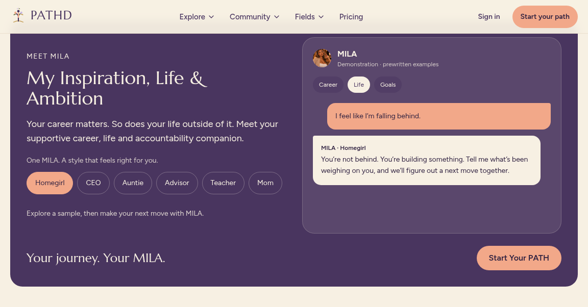

Review branch only. Main remains unchanged until user approval. [MILA preview screenshots](docs/previews/v0.1.3/README.md) · [Setup and shared SQL prerequisites](config/V0_1_3_SETUP.md).



# PATHD 0.1.3 — independent migration preview

Read PROJECT_OVERVIEW.md and PROJECT_HANDOFF.md first. Continue using the existing AELIO × PATHD Supabase project; do not create a new project. Current Cloudflare build is `npm run build:cloudflare`. Validated source is pushed only to PATHD; existing Git integration may deploy it automatically. No manual deployment is performed. See config/V0_1_2_SETUP.md. Historical Netlify/GitHub setup notes below are not authorization to deploy or push.

---

# PATHD — Find your path

Career platform: jobs with pay up front, explainable matching, career routes, and community.
See `PRODUCT_SPEC.md` for the product rules and `IMPLEMENTATION_STATUS.md` for progress.

## Run it

```bash
npm install
cp .env.example .env.local   # add public Supabase credentials; missing keys disable account features
npm run dev                  # http://localhost:3000
npm test                     # match-engine tests
```

**Demo mode** (no env vars): everything works with fictional data and a demo member. Nothing is saved.

## Connect Supabase

1. Create a project at supabase.com and enable the PostGIS extension.
2. Run `supabase/migrations/0001_phase1.sql`, `0002_staff_access.sql`, then `0003_portfolios.sql`, in the SQL editor (or `supabase db push`).
3. Optionally load `supabase/seed.sql` for demo jobs (flagged `is_demo`). Don't load it in production.
4. Fill `NEXT_PUBLIC_SUPABASE_URL`, `NEXT_PUBLIC_SUPABASE_ANON_KEY`, and `NEXT_PUBLIC_SITE_URL` in `.env.local`.
5. Add `ANTHROPIC_API_KEY` to enable automatic resume reading.

## Key decisions
- Demo mode runs on labeled sample data when Supabase isn't configured; swapping in Supabase changes only the data layer.
- Pay integrity is enforced in types, UI and database constraints. Matching is plain code, never AI, and never uses protected traits.
- AI sits behind a provider interface (`src/lib/ai`); its output is always a draft the member reviews.
- Locations shown are city-level at most; member search centers stay owner-only.
- Large uploads (portfolios) go straight from the browser to private storage via one-time signed URLs.

## Staff pages (founders and PATHD Team)
Mission Control lives at `/admin/mission-control`. Only accounts in `staff_members` can open it;
everyone else sees a "Road closed ahead, rerouting" screen and is sent to their dashboard (signed in) or the home page (signed out). No staff data is ever sent to them. After running `0002_staff_access.sql`, sign up with
your founder email, then run in the Supabase SQL editor:

```sql
insert into staff_members (profile_id, role)
select id, 'founder' from auth.users where email = 'you@yourdomain.com';
```

Founders can then add teammates (role `team`). Staff links never appear in member navigation.

## Put it on GitHub
1. Create a new **private** repository on GitHub named `pathd` (don't add a README; this one is included).
2. Upload the contents of this folder, or from a terminal:
   ```bash
   git init && git add . && git commit -m "PATHD Phase 1"
   git branch -M main
   git remote add origin https://github.com/<your-username>/pathd.git
   git push -u origin main
   ```
3. After your first `npm install`, commit the generated `package-lock.json`.

Never commit `.env.local` or any keys. `.gitignore` already excludes them.

## Deploy on Netlify
1. At netlify.com choose **Add new project → Import from Git** and pick the `pathd` repo.
   Build settings come from `netlify.toml`.
2. Historical note: missing production variables now disable account features rather than creating demo sessions. Local demo mode requires an explicit NEXT_PUBLIC_PATHD_DEMO_MODE=true and is unavailable in production.
3. Then add the variables from `.env.example` under **Site settings → Environment variables**
   (set `NEXT_PUBLIC_SITE_URL` to your Netlify address) and redeploy.
4. Add your custom domain under **Domain management**. HTTPS is automatic.
5. Turn on usage alerts in billing.

## Continuous checks
`.github/workflows/ci.yml` runs type-checking, tests and a production build on every push.

## Structure
```
src/app/(marketing)   landing, pricing, legal
src/app/(auth)        sign in / sign up + server actions
src/app/onboarding    5-step setup
src/app/(app)         member area: home, jobs, profile (+ upcoming features)
src/app/api           resume parsing
src/components        brand, ui, jobs, layout, marketing, onboarding
src/lib               salary, match, geo, ai, resume, data (repositories + demo), supabase
supabase/             migrations and demo seed
```
